# Awesome Regulatory Compliance & DLP Monitoring

  

  
  
  
  
  
  

> 🛡️ **A curated collection of top Regulatory Compliance and Data Loss Prevention (DLP) Monitoring platforms** — featuring enterprise GRC SaaS automation platforms, real-time data loss prevention engines, and production-ready open-source security tools for audit readiness, sensitive data discovery, and PII exposure monitoring.  
> 🌟 *Star this repository if you find it helpful for your security and compliance roadmap!* 🌟

---

## 📑 Table of Contents

- [🌐 Sector Overview & Market Dynamics](#-sector-overview--market-dynamics)
- [☁️ SaaS / Hosted Platforms](#-saas--hosted-platforms)
- [💻 Open-Source Software](#-open-source-software)
- [📊 Comparison at a Glance](#-comparison-at-a-glance)
- [🎯 Frameworks & Key Standards](#-frameworks--key-standards)
- [🤝 Contributing](#-contributing)
- [💖 Support](#-support)
- [⭐ Star History](#-star-history)
- [📄 License](#-license)

---

## 🌐 Sector Overview & Market Dynamics

The global Data Loss Prevention (DLP) and automated compliance monitoring sector is valued at **~$3.5B to $4.9B** and projected to reach **~$13.8B by 2032–2034**, expanding at a robust **11% to 18% CAGR** driven by escalating statutory mandates (GDPR, HIPAA, PCI-DSS v4.0, SOC 2, ISO 42001) and heavy regulatory breach fines.

The market remains **moderately to highly fragmented**: traditional infrastructure and endpoint security giants (Broadcom, Trellix, Forcepoint) share market share with cloud-native hyperscaler offerings (Microsoft Purview) and fast-growing GRC unicorns (Vanta, Drata, Secureframe), resulting in high ongoing M&A consolidation rather than a single winner-take-all monopoly.

---

## ☁️ SaaS / Hosted Platforms

Commercial, cloud-hosted Regulatory Compliance automation suites and enterprise Data Loss Prevention (DLP) monitoring solutions. Sorted by company scale (Valuation / Revenue descending):

| SaaS Solution | Scale (Valuation / ARR) | Starting Tier Pricing | Free Tier / Trial Limit | Key Focus & Compliance Capabilities |
| :--- | :--- | :--- | :--- | :--- |
| [**Vanta**](https://www.vanta.com/) | 🦄 **$4.15B Valuation** 📈 *$300M+ ARR* | **$7,500/year** (Essentials Plan, 1 framework for startups &lt;50 employees) | **No free tier or public self-serve trial** (Demo & customized guided pilot only) | Agentic trust management, continuous evidence lifecycle collection, automated ISO 42001 / SOC 2 / HIPAA compliance, and Trust Center. |
| [**Drata**](https://drata.com/) | 🦄 **$2.0B Valuation** 📈 *$100M+ ARR* | **$7,500/year** (Foundation Plan, single framework for early-stage teams) | **No free tier or self-serve trial** (Requires sales consultation & guided PoC) | Automated continuous control monitoring across 20+ frameworks, SafeBase interactive Trust Center, and custom no-code remediation workflows. |
| [**Druva**](https://www.druva.com/) | 🦄 **$2.0B Valuation** 📈 *$200M+ ARR* | **$8/user/month** (Enterprise endpoint backup baseline; workload tiers scale by consumed TB) | **30-Day Free Trial** (Full evaluation environment, cloud backup testing, sensitive data governance console) | Cloud-native data resiliency, sensitive data governance dashboard, endpoint DLP, remote wipe, and delegated end-user violation resolution. |
| [**Secureframe**](https://secureframe.com/) | 🏢 **$500M Valuation** 📈 *$25M+ ARR* | **$7,500/year** (Fundamentals tier, single framework, baseline continuous monitoring) | **No free tier or public trial** (Guided enterprise product walkthrough & scoped demo) | 300+ native cloud integrations, Comply AI remediation, vendor risk management, and federal CMMC / FedRAMP readiness automation. |
| [**Thoropass**](https://thoropass.com/) | 🏢 **$300M Valuation** 📈 *$43M+ ARR* | **$14,500/year** (Bundled entry: ~$8,700/yr platform + ~$5,800/yr audit subscription) | **14-Day Free Trial** (Specifically for Due Diligence Questionnaire / DDQ automation module only) | Unified software + audit partner model, streamlined multi-framework audits for SOC 2, ISO 27001, HITRUST, DORA, C5, and CSA STAR. |
| [**TrustArc**](https://trustarc.com/) | 🏢 **$150M+ Valuation** 📈 *$55M–$82M ARR* | **$10,000/year** (Privacy Studio baseline for privacy risk & cookie consent) | **No permanent free tier** (Limited 14-day evaluation accounts available for Nymity regulatory research) | Arc Intelligence explainable AI, 1,000+ global data privacy regulations mapped with citations, DSAR management, and Cookie Consent Studio. |
| [**Scrut Automation**](https://www.scrut.io/) | 🏢 **$75M Valuation** 📈 *$10M+ ARR* | **$15,000/year** (Entry-level compliance automation for small teams &lt;20 employees) | **No free tier or trial** (Demo-gated platform access via compliance engineering team) | Scrut Teammates AI agents, proprietary risk knowledge graph, ISO 42001 certified AI risk governance, and automated gap remediation. |
| [**Hyperproof**](https://hyperproof.io/) | 🏢 **$72.5M+ Valuation** 📈 *$40M–$45M ARR* | **$12,000/year** (Professional tier, includes unlimited user seats) | **No free tier or public trial** (Scheduled personalized product demo and custom pilot) | AI Guided Experiences, automated evidence health checks, cross-framework control mapping, and unified risk register management. |
| [**Sprinto**](https://sprinto.com/) | 🏢 **$60M+ Valuation** 📈 *$12M–$15M ARR* | **$6,000/year** (Starter tier for early-stage companies for single framework) | **No free tier or hands-on public trial** (Personalized product scoping demo) | 200+ digitized controls, 25+ automated frameworks, multi-entity approval workflows, ISO 27005 risk mapping, and continuous audit health checks. |

---

## 💻 Open-Source Software

Self-hosted, transparent, and community-driven tools for data loss prevention, regulatory compliance monitoring, security posture scanning, and sensitive data discovery.

> ℹ️ *Sorted descending by GitHub star counts. Click the star badge beside each project to inspect community stargazers.*

### 1. [Gitleaks](https://github.com/gitleaks/gitleaks) 
* **Stack:** Go | **License:** MIT
* **Description:** Ultra-fast, battle-tested scanner for finding and preventing hardcoded secrets, API tokens, passwords, and private keys in Git repositories, local files, and CI/CD pipelines. Features regex rule-sets, entropy checking, pre-commit hook enforcement, and developer workflow gates.
* **Best For:** DevOps and engineering teams requiring developer-side DLP gating across commits, pull requests, and CI/CD pipelines.

### 2. [TruffleHog](https://github.com/trufflesecurity/trufflehog) 
* **Stack:** Go | **License:** AGPL-3.0
* **Description:** Deep credential and secrets detection engine that scans git history, branches, file systems, and S3 buckets. Distinctively supports live credential verification against 800+ API providers to confirm whether leaked keys are active and exploitable.
* **Best For:** AppSec teams auditing historical codebase exposure and verifying real-world exploitability of leaked sensitive credentials.

### 3. [Wazuh](https://github.com/wazuh/wazuh) 
* **Stack:** C / C++ / Python / OpenSearch | **License:** GPL-2.0
* **Description:** Comprehensive open-source SIEM, XDR, and File Integrity Monitoring (FIM) platform. Features out-of-the-box compliance monitoring modules for PCI-DSS, GDPR, HIPAA, and NIST 800-53, plus custom regex and PAN detection rules to capture unmasked cardholder data and file tampering.
* **Best For:** SOC and infrastructure teams seeking unified host-based compliance monitoring, regulatory audit log telemetry, and FIM file change detection.

### 4. [Prowler](https://github.com/prowler-cloud/prowler) 
* **Stack:** Python | **License:** Apache-2.0
* **Description:** Leading open-source security tool for AWS, Azure, GCP, and Kubernetes cloud compliance assessments. Automates continuous checks against CIS Benchmarks, NIST, ISO 27001, GDPR, HIPAA, and PCI-DSS, identifying misconfigured storage and exposed sensitive cloud assets.
* **Best For:** Cloud security engineers requiring automated multi-cloud compliance posture assessments and continuous infrastructure auditing.

### 5. [Microsoft Presidio](https://github.com/data-privacy-stack/presidio) 
* **Stack:** Python | **License:** MIT
* **Description:** Extensible NLP-powered framework for detecting, redacting, and anonymizing Personally Identifiable Information (PII) in text, DICOM medical files, and images. Ships with 50+ predefined recognizers (SSN, credit cards, IBAN, names, locations) and pluggable modules for hashing, masking, and encrypting data streams.
* **Best For:** Data engineering and AI teams needing programmatic PII redaction and privacy sanitization across ETL pipelines and LLM context windows.

### 6. [Steampipe](https://github.com/turbot/steampipe) 
* **Stack:** Go / PostgreSQL | **License:** AGPL-3.0
* **Description:** SQL-based multi-cloud inspection engine that exposes cloud infrastructure, SaaS APIs, and GitHub as relational tables. Offers open-source compliance suites (`steampipe-mod-aws-compliance`) for querying CIS, HIPAA, and NIST compliance rules using plain SQL statements.
* **Best For:** Security auditors and infrastructure engineers who prefer querying compliance benchmarks and asset inventories via standard SQL.

### 7. [American Express EarlyBird](https://github.com/americanexpress/earlybird) 
* **Stack:** Go | **License:** Apache-2.0
* **Description:** Open-source sensitive data detection scanner developed by American Express to inspect source code repositories, filesystems, and directories for cleartext passwords, PII, deprecated cryptographic algorithms, and secret keys prior to deployment.
* **Best For:** Enterprise security teams seeking an auditor-approved code scanner customized for financial and regulatory compliance checks.

### 8. [HAWK Eye](https://github.com/rohitcoder/hawk-eye) 
* **Stack:** Python | **License:** Apache-2.0
* **Description:** Sensitive data discovery scanner covering databases (MySQL, PostgreSQL, MongoDB, Redis), S3, GCS, Slack, and local files. Runs OCR across 350+ file formats (including scanned PDFs, DOCX, and images) to track down PII wherever files migrate across corporate repositories.
* **Best For:** Security auditors needing forensic data discovery across unstructured cloud buckets, databases, and collaboration media.

### 9. [Openlane Core](https://github.com/theopenlane/core) 
* **Stack:** Go / GraphQL / PostgreSQL | **License:** Apache-2.0
* **Description:** Modern, self-hostable compliance automation platform designed as an open-source alternative to Vanta and Drata. Provides full GRC modules for control mapping, evidence collection, vendor risk assessments, policy tracking, and public Trust Center publishing.
* **Best For:** Organizations seeking a self-hosted GRC platform to manage SOC 2, ISO 27001, and GDPR evidence without proprietary SaaS lock-in.

### 10. [Data Boar](https://github.com/DataBoar/data-boar) 
* **Stack:** Python / SQLite | **License:** Apache-2.0
* **Description:** Local-first, privacy-conscious PII scanner and evidence collector for databases, network shares, filesystems, and APIs. Analyzes data severity, outputs audit-ready SQLite records, and produces structured Excel heatmaps for DPOs preparing for GDPR and LGPD audits.
* **Best For:** Data Protection Officers (DPOs) and compliance auditors preparing gap analyses and technical evidence for data privacy audits.

### 11. [Lacuna](https://github.com/witlox/lacuna) 
* **Stack:** Python / PostgreSQL / OPA | **License:** MIT
* **Description:** Policy-driven data governance and sensitive classification engine. Integrates lineage tracking, automated classification heuristics, and Open Policy Agent (OPA) policy-as-code to enforce fine-grained data transfer and retention rules with tamper-evident audit logs.
* **Best For:** Data platform architects requiring automated data lineage tagging and policy-as-code enforcement during ETL transformations.

---

## 📊 Comparison at a Glance

| Software Solution | Category | License / Deployment | Compliance Automation | DLP / PII Detection | Policy-as-Code Engine | Continuous Monitoring | Primary Strengths |
| :--- | :--- | :--- | :---: | :---: | :---: | :---: | :--- |
| **Vanta** | SaaS | Commercial Cloud | ✅ | ❌ | AI Policy Ops | ✅ | Autonomous agentic compliance, ISO 42001 certification |
| **Drata** | SaaS | Commercial Cloud | ✅ | ❌ | No-Code Builder | ✅ | SafeBase Trust Center, 20+ frameworks, multi-HRIS syncing |
| **Druva** | SaaS | Commercial Cloud | ❌ | ✅ | Rules Engine | ✅ | Endpoint sensitive data discovery, remote wipe, backup DLP |
| **Secureframe** | SaaS | Commercial Cloud | ✅ | ❌ | Comply AI | ✅ | 300+ integrations, transparent tiers, CMMC federal readiness |
| **Thoropass** | SaaS | Commercial Cloud | ✅ | ❌ | Custom Rules | ✅ | Integrated audit partner model, DORA / C5 / HITRUST coverage |
| **TrustArc** | SaaS | Commercial Cloud | (Privacy GRC) | ❌ | Arc Intelligence | ✅ | 1,000+ citation-backed privacy regulations, DSAR workflows |
| **Scrut Automation**| SaaS | Commercial Cloud | ✅ | ❌ | AI Workflows | ✅ | ISO 42001 AI risk management, Scrut Teammates agents |
| **Hyperproof** | SaaS | Commercial Cloud | ✅ | ❌ | Custom Workflows | ✅ | AI Suggested Links, evidence health check, unlimited seats |
| **Sprinto** | SaaS | Commercial Cloud | ✅ | ❌ | Multi-Approval | ✅ | Fast sprint-based onboarding, 200+ digitized controls |
| **Gitleaks** | OSS | MIT (Self-Hosted) | ❌ | ✅ (Secrets/Keys) | Regex Config | (CI/CD) | Ultra-fast pre-commit and CI/CD secret scanning |
| **TruffleHog** | OSS | AGPL-3.0 (Self-Hosted)| ❌ | ✅ (Secrets/Keys) | Rule Detectors | (Git Scans) | Live API key validation, deep commit history analysis |
| **Wazuh** | OSS | GPL-2.0 (Self-Hosted)| ✅ (SIEM/Rules) | ✅ (Regex/PAN) | XML/Decoders | ✅ | File integrity monitoring, SIEM, PCI-DSS / HIPAA auditing |
| **Prowler** | OSS | Apache-2.0 (Self-Hosted)| ✅ (Cloud Posture)| ❌ | Custom Checks | ✅ | Multi-cloud CIS, NIST, ISO 27001 automated compliance scans |
| **Presidio** | OSS | MIT (Self-Hosted) | ❌ | ✅ (PII & NLP) | Custom Recognizers| (Pipeline) | Enterprise NLP-based PII identification and anonymization |
| **Steampipe** | OSS | AGPL-3.0 (Self-Hosted)| ✅ (Compliance Mods)| ❌ | SQL Queries | (Query-time) | SQL querying of live cloud security controls and benchmarks |
| **EarlyBird** | OSS | Apache-2.0 (Self-Hosted)| ❌ | ✅ (PII & Secrets)| Custom Signatures | (Build-time) | Pre-deployment source code sensitive data scanning |
| **HAWK Eye** | OSS | Apache-2.0 (Self-Hosted)| ❌ | ✅ (OCR & 350+ Files)| YAML Signatures | (Batch Scans) | Multi-storage PII discovery across databases and S3 buckets |
| **Openlane Core** | OSS | Apache-2.0 (Self-Hosted)| ✅ (Full GRC) | ❌ | Workflow Engine | ✅ | Comprehensive self-hosted open-source alternative to Vanta |
| **Data Boar** | OSS | Apache-2.0 (Self-Hosted)| ❌ | ✅ (PII Inventory) | Normative Rules | (On-demand) | Forensic PII triage, heatmap generation for DPO audits |
| **Lacuna** | OSS | MIT (Self-Hosted) | ❌ | ✅ (Lineage Tags) | OPA (Rego) | (ETL-time) | Lineage-aware governance, policy-as-code classification |

---

## 🎯 Frameworks & Key Standards

The tools in this catalog assist security and governance teams in fulfilling controls for:

* **SOC 2 (Type I & Type II):** Trust Services Criteria for Security, Availability, Processing Integrity, Confidentiality, and Privacy.
* **ISO/IEC 27001:2022 & ISO 42001:** Information security management and artificial intelligence governance systems.
* **HIPAA Security & Privacy Rules:** Safeguards for protected health information (ePHI) discovery and breach prevention.
* **GDPR & CCPA / CPRA:** Data minimization, right-to-be-forgotten (DSAR), and cross-border data transfer compliance.
* **PCI-DSS v4.0:** Primary Account Number (PAN) discovery, tokenization, cardholder environment isolation, and continuous file integrity monitoring.
* **NIST SP 800-53 / CMMC:** Federal security controls, assessment objectives, and system security plan (SSP) generation.
* **DORA (Digital Operational Resilience Act):** European operational risk management and ICT third-party service provider oversight.

---

## 🤝 Contributing

Contributions, issues, and feature proposals are welcomed with open arms!

1. Fork the Project 🍴
2. Create your Feature Branch (`git checkout -b feature/AddAwesomeTool`)
3. Commit your Changes (`git commit -m "Add new compliance or DLP tool"`)
4. Push to the Branch (`git push origin feature/AddAwesomeTool`)
5. Open a Pull Request 🚀

*Please ensure submitted open-source tools are actively maintained (commit/release within the past 12 months) and properly categorized with stack and licensing details.*

---

## 💖 Support

A huge thank you to everyone exploring, using, and contributing to this curated compliance and DLP catalog! If you find this repository valuable:

- ⭐ **Star this repository** to support discovery and help other engineers find it.
- 🍴 **Fork and share** with colleagues, devops teams, and security practitioners.
- ☕ **Buy me a coffee / sponsor:** If this saved you time or aided your evaluation roadmap, consider supporting the work via the [**GitHub Sponsors Dashboard**](https://github.com/sponsors/ishandutta2007) — every bit of support is deeply appreciated!

---

## ⭐ Star History

---

## 📄 License

This repository and curated list are released under the [CC0 1.0 Universal (Public Domain Dedication)](./LICENSE).  
Individual listed tools and products remain the intellectual property and copyright of their respective owners and vendors.

---

  ⭐ <b>Found this resource valuable? Give it a star to help other security engineers and GRC practitioners!</b> ⭐

